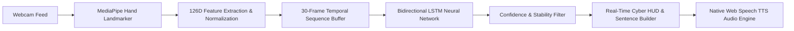

# 🤟 Indian Sign Language (ISL) AI Studio & Recognition System


An end-to-end, real-time Computer Vision and Deep Learning studio engineered for **Indian Sign Language (ISL)** translation, gesture audio synthesis, interactive learning, dataset recording, and model training.

The system captures dual-hand 3D coordinates via **Google MediaPipe**, processes temporal gesture sequences using a **Bidirectional Long Short-Term Memory (Bi-LSTM)** network, and renders real-time translations through a **Cyberpunk-themed Web Studio** complete with instant text-to-speech (TTS) voice synthesis.

---

## 📑 Table of Contents

- [Key Features](#-key-features)
- [System Architecture](#-system-architecture)
- [Project Directory Structure](#-project-directory-structure)
- [Prerequisites & Installation](#-prerequisites--installation)
- [Quick Start](#-quick-start)
- [Web Studio Overview](#-web-studio-overview)
- [CLI Tools & Standalone Mode](#-cli-tools--standalone-mode)
- [Data Pipeline & Model Retraining](#-data-pipeline--model-retraining)
- [Supported Vocabulary](#-supported-vocabulary)
- [Troubleshooting & FAQs](#-troubleshooting--faqs)

---

## ✨ Key Features

- **🔮 Real-Time Live AI Translator**:
  - Live webcam stream with high FPS detection.
  - Multi-hand tracking with futuristic neon skeletal visualizers.
  - 30-frame temporal buffer with confidence threshold gating.
  - Phrase accumulator with **Undo**, **Clear**, and **Speak All** controls.
  - Zero-latency spoken voice feedback powered by the browser's native **Web Speech API**.

- **📚 Interactive ISL Sign Dictionary**:
  - Comprehensive guide covering **100+ signs and phrases** across 10 categories.
  - Filter by category, keyword search, or view only actively trained signs.
  - Step-by-step gesture breakdowns, hand positioning, and movement directions.

- **🎯 Gamified Practice Studio**:
  - Real-time gesture evaluation challenge.
  - Live hold-match confidence meter and countdown timer.
  - Gamified score tracking (+100 PTS), streak tracker, visual confetti celebrations, and voice cheers.

- **🎙️ In-Browser Dataset Studio & Trainer**:
  - Capture new gesture sequences directly inside the browser UI with a 3-second visual countdown.
  - Support for both standard ISL vocabulary and custom user-defined signs.
  - Live dataset distribution analytics and sample count histograms.
  - One-click dataset preprocessing and Bi-LSTM model retraining from within the application.

- **📊 Deep System Diagnostics**:
  - Real-time inspection of active classes, tensor shapes (126 features, 30 frames, 103+ classes), and execution engine (CPU/CUDA GPU).
  - Neural network specification breakdown.
  - Built-in diagnostic accuracy evaluation test across dataset samples.

---

## 🧠 System Architecture



### 1. Dual-Hand Landmark Extraction (`feature_extractor.py`)
- Detects up to **2 hands** per frame using MediaPipe's `hand_landmarker.task`.
- Extracts 21 3D landmarks $(X, Y, Z)$ per hand:
  - Left Hand: $21 \times 3 = 63$ coordinates
  - Right Hand: $21 \times 3 = 63$ coordinates
  - **Combined Vector**: **126 dimensions per frame**
- Robust selfie-mirror correction that maps mirrored webcam feeds to the user's physical left and right hands.
- **Invariant Normalization**: Wrist-relative translation centering and scale normalization ensure the model is robust to camera distance and hand sizes.

### 2. Temporal Bi-LSTM Classifier (`model.py`)
- **Input Dimension**: `(batch_size, 30, 126)` representing ~1 second of motion at 30 fps.
- **Architecture**:
  - 2-layer Bidirectional LSTM (Hidden size = 128 per direction $\rightarrow$ 256 bidirectional outputs).
  - Layer Normalization & Dropout ($p = 0.30$) for regularization.
  - Temporal Mean-Pooling across all 30 time steps.
  - Classification Head: `Linear(256 -> 128) -> ReLU -> Dropout(0.3) -> Linear(128 -> NumClasses)`.
  - Output: Multi-class Softmax probability distribution.

---

## 📂 Project Directory Structure

```text
ISL_Sign_Language_Project/
├── app.py                     # Main Streamlit Cyberpunk Web Studio
├── model.py                   # PyTorch SignLSTM neural network architecture
├── feature_extractor.py       # MediaPipe HandLandmarker wrapper & sequence normalizer
├── labels.py                  # Category mappings, sign vocabulary & configuration constants
├── sign_dictionary.py         # Knowledge base with instructions and step-by-step guides
├── ui_hud.py                  # OpenCV cyber HUD, neon skeleton renderer & bounding boxes
├── ui_tts.py                  # HTML5 Web Speech API audio synthesis bridge
├── preprocess_data.py         # Dataset cleaner, dual-slot padding & train/test split
├── train_lstm.py              # PyTorch training pipeline with Cosine Annealing & AdamW
├── check_model.py             # CLI diagnostic script for model validation & accuracy
├── realtime_lstm.py           # Standalone desktop OpenCV real-time recognition window
├── record_dataset.py          # Interactive CLI dataset recorder
├── run_app.bat                # Windows 1-click batch launcher
├── hand_landmarker.task       # MediaPipe pre-trained vision model binary
├── lstm_model.pth             # Trained PyTorch Bi-LSTM model checkpoint
├── requirements.txt           # Python dependency specification
├── data/                      # Raw recorded landmark sequence files (.npy)
├── processed/                 # Preprocessed train/test numpy splits & label_map.json
└── .streamlit/
    └── config.toml            # Streamlit theme & server configuration
```

---

## ⚙️ Prerequisites & Installation

### 1. System Requirements
- **OS**: Windows 10/11, macOS, or Linux.
- **Python**: Version 3.10 or higher.
- **Hardware**: Standard HD webcam (720p or 1080p). Dedicated GPU (CUDA) is supported but not required.

### 2. Environment Setup

Clone or navigate to the project directory:
```bash
cd ISL_Sign_Language_Project
```

Create and activate a virtual environment:

**Windows (PowerShell):**
```powershell
python -m venv .venv
.\.venv\Scripts\Activate.ps1
```

**Windows (Command Prompt):**
```cmd
python -m venv .venv
.\.venv\Scripts\activate.bat
```

**macOS / Linux:**
```bash
python3 -m venv .venv
source .venv/bin/activate
```

### 3. Install Dependencies
```bash
pip install -r requirements.txt
```

Verify that `hand_landmarker.task` is located in the root project folder.

---

## 🚀 Quick Start

### Method 1: Windows One-Click Launcher
Double-click `run_app.bat` or run:
```cmd
run_app.bat
```

### Method 2: Launch via Streamlit
Activate your virtual environment and launch the studio:
```bash
python -m streamlit run app.py
```
Open your browser to: **`http://localhost:8501`**

---

## 🖥️ Web Studio Overview

The web studio is divided into 5 core workspaces:

| Workspace | Purpose |
| :--- | :--- |
| **🔮 Live AI Translator** | Real-time recognition, sentence builder, neon skeletons, confidence tuning, and speech synthesis. |
| **📚 Sign Dictionary** | Interactive search and detailed physical instructions for 100+ ISL signs. |
| **🎯 Practice Studio** | Timed interactive quizzes to practice signs and earn points and streaks. |
| **🎙️ Dataset Studio & Trainer** | Record new sign sequences with camera countdown and retrain the model with 1 click. |
| **📊 System Diagnostics** | Inspect network weights, feature dimensionality, GPU availability, and benchmark accuracy. |

---

## 💻 CLI Tools & Standalone Mode

In addition to the Streamlit UI, the repository includes standalone command-line tools:

### Standalone OpenCV Real-Time Window
For minimal latency and dedicated window display without a web browser:
```bash
python realtime_lstm.py
```
*Press `Q` to exit.*

### Interactive CLI Dataset Recorder
Capture sequences for specific signs or whole categories:
```bash
python record_dataset.py
```

### Model Accuracy & Diagnostic Check
Evaluate sample files in `data/` against `lstm_model.pth`:
```bash
python check_model.py
```

---

## 🔄 Data Pipeline & Model Retraining

To train the model on new or updated data:

1. **Collect Data**: Record new samples using **Tab 4** of the web app or via `record_dataset.py`. Sequences are stored in `data/<SIGN_NAME>/sequence_XXX.npy`.
2. **Preprocess Sequences**:
   ```bash
   python preprocess_data.py
   ```
   *Normalizes landmarks, applies dual-hand slot alignment, and creates `processed/label_map.json` and train/test splits.*
3. **Train Bi-LSTM**:
   ```bash
   python train_lstm.py
   ```
   *Trains the PyTorch model for 60 epochs with Cosine Annealing, saving the best checkpoint to `lstm_model.pth`.*
4. **Reload Studio**: Return to the Streamlit web studio and your newly trained signs are immediately ready.

---

## 📖 Supported Vocabulary

The project supports **103+ signs and phrases** categorized across everyday domains:

- **🔢 Numbers**: `1` through `9`
- **🔤 Alphabet**: `A` through `Z`
- **🦁 Animals & Wildlife**: `BEAR`, `CROCODILE`, `DEER`, `ELEPHANT`, `GIRAFFE`, `LION`, `MONKEY`, `PEACOCK`, `PIGEON`, `SPARROW`, `TIGER`, `TURTLE`, `VOLCANO`
- **🥦 Food & Cooking**: `BRINJAL`, `CABBAGE`, `CARROT`, `CAULIFLOWER`, `CHILLI`, `COOK`, `CUCUMBER`, `DRINK`, `LEMON`, `ONION`, `POUR`, `RADISH`, `TEA`, `VEGETABLES`
- **🏠 Everyday Objects & Actions**: `BREAK`, `BUDGET`, `BUSY`, `CLEAN`, `CLOSE`, `COME`, `CRY`, `EXAM`, `FEDUP`, `FEVER`, `GIVE`, `HUG`, `INJURY`, `INTERVIEW`, `JUMP`, `KARNATAKA`, `KEY`, `KNIFE`, `MAN`, `MATHS`, `MAYBE`, `STILL`, `SWITCH`, `TEMPLE`, `UMBRELLA`, `UNCLE`, `WIFE`, `WRITER`, `WRONG`
- **👋 Greetings & Phrases**: `GOOD_MORNING`, `GOOD_AFTERNOON`, `GOOD_NIGHT`, `HELLO`, `THANK_YOU`, `WHAT_IS_YOUR_NAME`, `YES`, `NO`, `PLEASE`, `NICE_TO_MEET_YOU`, `SEE_YOU_LATER`, `HAVE_A_GOOD_DAY`, `SORRY`, `EXCUSE_ME`, `YOU_ARE_WELCOME`, `MY_NAME_IS`
- **💬 Daily Communication**: `I_UNDERSTAND`, `I_DO_NOT_UNDERSTAND`, `CAN_YOU_REPEAT`, `SPEAK_SLOWLY`, `I_AGREE`, `I_DO_NOT_KNOW`, `OF_COURSE`, `NEVER_MIND`, `WAIT_A_MINUTE`
- **🆘 Health, Safety & Emergency**: `CALL_AN_AMBULANCE`, `CALL_THE_POLICE`, `I_FEEL_SICK`, `I_HAVE_PAIN`, `I_AM_LOST`, `IT_IS_AN_EMERGENCY`, `DO_NOT_TOUCH`, `BE_CAREFUL`, `I_AM_FINE`, `CALL_MY_FAMILY`

---

## 🛠️ Troubleshooting & FAQs

### Camera fails to open or throws `Could not open camera`
- Make sure no other program (such as Zoom, Teams, or another Python terminal) is locking the webcam.
- If using an external USB camera, change the **Camera Device Index** in the sidebar (e.g., from `0` to `1` or `2`).

### Text-to-Speech (TTS) audio is silent
- Ensure your browser allows audio autoplay for `localhost`.
- Check that your system speaker volume is unmuted and the **Enable Spoken Audio** checkbox in the sidebar is turned on.

### Low FPS or video lag
- In the sidebar, toggle off **Show Neon Hand Skeletons** to minimize per-frame drawing overhead.
- Ensure your machine is running on AC power / high-performance mode.

### `hand_landmarker.task` not found error
- Make sure `hand_landmarker.task` is located in the project root directory. If missing, download it from Google MediaPipe's official model repository.

---

## 📜 License

This project is licensed under the **MIT License**. Feel free to use, adapt, and build upon it for research, educational, or commercial purposes.
